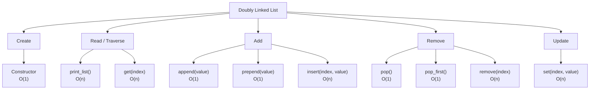

# Doubly Linked Lists

A doubly linked list (DLL) stores a value plus `next` and `prev` references in each node. These notes cover its structure, operations, pointer changes, edge cases, and time complexity.

## What is a Doubly Linked List?
A **doubly linked list (DLL)** is a sequence of nodes where each node stores:
- **value** → the data
- **next** → reference to the next node
- **prev** → reference to the previous node
Because every node has both directions, we can move **forward and backward** through the list.
Example:
```plain text
None ← [10] ⇄ [20] ⇄ [30] → None
         ↑                 ↑
        head              tail
```
The arrows mean:
```plain text
[10] ⇄ [20]
      ↙    ↘
   prev    next
```
A singly linked list has only `next`; a doubly linked list has **`next` and `prev`**.
---
## Why use a Doubly Linked List?
The extra `prev` reference uses more memory, but it gives us an important advantage:
> We can move in **both directions**.
This is especially useful when removing or inserting nodes near the end or when we already have a reference to a node.
---
## Node Structure
A typical node:
```python
class Node:
    def __init__(self, value):
        self.value = value
        self.next = None
        self.prev = None
```
Visual model:
```plain text
┌─────────┬────────┬─────────┐
│  prev   │ value  │  next   │
└─────────┴────────┴─────────┘
     ↑                    ↓
 previous node      next node
```
---
## Doubly Linked List Structure
The list normally keeps three pieces of information:
```python
self.head
self.tail
self.length
```
Example:
```plain text
             head                     tail
              ↓                        ↓
None ←── [10] ⇄ [20] ⇄ [30] ⇄ [40] ──→ None
                                     
length = 4
```
### Important rules
- If the list is empty: **head = None, tail = None**
- The first node's `prev` is always **None**
- The last node's `next` is always **None**
- `length` stores the number of nodes
---
# Method Map
The main methods and what they change:

> **Big idea:** the operation itself may change only a few references, but finding the correct node can require traversal.
---
# 1. Constructor — O(1)
Creates the first node and makes it both the head and tail.
```python
def __init__(self, value):
    new_node = Node(value)
    self.head = new_node
    self.tail = new_node
    self.length = 1
```
Result:
```plain text
head
 ↓
[10]
 ↑
tail

10.prev = None
10.next = None
length = 1
```
**Time: O(1)**
Only one node and a fixed number of references are created.
---
# 2. print_list() — O(n)
Traverses the list and prints every value.
```python
def print_list(self):
    temp = self.head

    while temp is not None:
        print(temp.value)
        temp = temp.next
```
Example:
```plain text
head
 ↓
[10] ⇄ [20] ⇄ [30]

temp moves:
10 → 20 → 30 → None
```
**Time: O(n)**
Every node may be visited once.
---
# 3. append(value) — O(1)
Adds a new node to the end.
Before:
```plain text
[10] ⇄ [20] ⇄ [30] → None
                    ↑
                   tail
```
Create `40`:
```plain text
new_node = [40]
```
Change the two connections:
```python
new_node.prev = self.tail
self.tail.next = new_node
self.tail = new_node
self.length += 1
```
After:
```plain text
[10] ⇄ [20] ⇄ [30] ⇄ [40] → None
                             ↑
                            tail
```
**Time: O(1)** because we already have a tail reference.
---
# 4. prepend(value) — O(1)
Adds a new node to the beginning.
Before:
```plain text
None ← [10] ⇄ [20] ⇄ [30]
        ↑
       head
```
Add `5`:
```python
new_node.next = self.head
self.head.prev = new_node
self.head = new_node
self.length += 1
```
After:
```plain text
None ← [5] ⇄ [10] ⇄ [20] ⇄ [30]
        ↑                       ↑
       head                    tail
```
For an empty list, the new node becomes **both head and tail**.
**Time: O(1)**
---
# 5. pop() — O(1)
Removes the last node.
This is where a doubly linked list has an advantage over a singly linked list.
Because the tail node has a `prev` reference, we can immediately reach the previous node.
Before:
```plain text
[10] ⇄ [20] ⇄ [30]
              ↑
             tail
```
Move the tail backward:
```python
self.tail = self.tail.prev
self.tail.next = None
self.length -= 1
```
After:
```plain text
[10] ⇄ [20] → None
              ↑
             tail
```
**Time: O(1)**
No traversal is needed.
### Important comparison
**Singly linked list:** removing the last node → **O(n)**  
**Doubly linked list:** removing the last node → **O(1)**
The `prev` reference is what makes the difference.
---
# 6. pop_first() — O(1)
Removes the first node.
Before:
```plain text
head
 ↓
[10] ⇄ [20] ⇄ [30]
```
Move the head forward:
```python
self.head = self.head.next
self.head.prev = None
self.length -= 1
```
After:
```plain text
None ← [20] ⇄ [30]
         ↑
        head
```
If the list becomes empty:
```python
self.head = None
self.tail = None
```
**Time: O(1)**
---
# 7. get(index) — O(n)
Returns the node at a specific index.
Unlike a normal Python list, a linked list cannot jump directly to an index.
However, a doubly linked list can choose the **shorter direction**:
- Start from **head** if the index is closer to the beginning.
- Start from **tail** if the index is closer to the end.
Conceptually:
```plain text
index:   0       1       2       3       4
       [10] ⇄ [20] ⇄ [30] ⇄ [40] ⇄ [50]
         ↑                               ↑
       head                            tail
```
For `get(4)`, starting from the tail is faster.
For `get(1)`, starting from the head is faster.
Even with this optimization, the **Big-O worst case is O(n)** because the number of nodes can still grow with `n`.
---
# 8. set(index, value) — O(n)
Changes the value of an existing node.
Example:
```plain text
Before:
[10] ⇄ [20] ⇄ [30]

set(1, 99)

After:
[10] ⇄ [99] ⇄ [30]
```
The steps are:
1. Find the node at the index.
2. Change its `value`.
The value change itself is **O(1)**, but finding the node is **O(n)**.
Therefore:
**Overall: O(n)**
---
# 9. insert(index, value) — O(n)
Adds a new node into the middle of the list.
Example: insert `99` at index 2.
Before:
```plain text
[10] ⇄ [20] ⇄ [30] ⇄ [40]
```
We want:
```plain text
[10] ⇄ [20] ⇄ [99] ⇄ [30] ⇄ [40]
```
The important part is reconnecting **both directions**.
Conceptually:
```plain text
Before:

A ⇄ B

After:

A ⇄ NEW ⇄ B
```
The new node must have:
```plain text
NEW.prev = A
NEW.next = B
```
And the neighboring nodes must be updated:
```plain text
A.next = NEW
B.prev = NEW
```
Special cases:
- index = 0 → use `prepend()`
- index = length → use `append()`
- middle → find the correct node, then change the links
**Time: O(n)**
The traversal to reach the insertion point dominates the operation.
---
# 10. remove(index) — O(n)
Removes the node at a specific index.
Example:
```plain text
Before:
[10] ⇄ [20] ⇄ [30] ⇄ [40]

Remove index 2
```
We remove `30`.
The list should become:
```plain text
[10] ⇄ [20] ⇄ [40]
```
The important step is **skipping over the target node in both directions**.
Conceptually:
```plain text
Before:

A ⇄ B ⇄ C

Remove B:

A ⇄ C
```
Update:
```plain text
A.next = C
C.prev = A
```
Special cases:
- index = 0 → use `pop_first()`
- index = length - 1 → use `pop()`
- otherwise → find the node and reconnect its neighbors
**Time: O(n)**
Finding the node takes O(n).
---
# The Most Important Pointer Changes
When inserting a node between two existing nodes:
```plain text
A ⇄ B
```
becomes:
```plain text
A ⇄ NEW ⇄ B
```
You must fix **four references**:
```python
new_node.prev = A
new_node.next = B
A.next = new_node
B.prev = new_node
```
When removing the middle node:
```plain text
A ⇄ B ⇄ C
```
becomes:
```plain text
A ⇄ C
```
Fix **two references**:
```python
A.next = C
C.prev = A
```
This is the core of doubly linked-list operations.
---
# Time Complexity Summary
| Method | Time | Main reason |
|---|---:|---|
| Constructor | O(1) | Fixed number of references |
| `print_list()` | O(n) | Visits every node |
| `append()` | O(1) | Tail reference is maintained |
| `prepend()` | O(1) | Head reference is maintained |
| `pop()` | O(1) | Tail has a `prev` reference |
| `pop_first()` | O(1) | Head changes directly |
| `get(index)` | O(n) | Must traverse to the node |
| `set(index, value)` | O(n) | Must find the node first |
| `insert(index, value)` | O(n) | Must reach the insertion point |
| `remove(index)` | O(n) | Must reach the target node |
---
## Easy Memory Rules
> **Head operations → O(1)**
> **Tail operations → O(1)**
> **Index-based operations → O(n)**
> **Traversal → O(n)**
The big advantage of a doubly linked list is:
> **Each node knows both its next and previous node.**
So when you already have the correct node, changing links can be very fast.
### Singly vs Doubly
```plain text
Singly:
[10] → [20] → [30]

Doubly:
[10] ⇄ [20] ⇄ [30]
```
**Singly:** forward only  
**Doubly:** forward + backward
That extra `prev` reference makes some operations easier and faster, especially removing the last node.