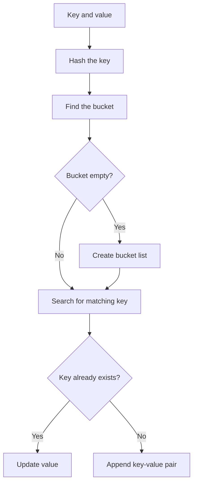
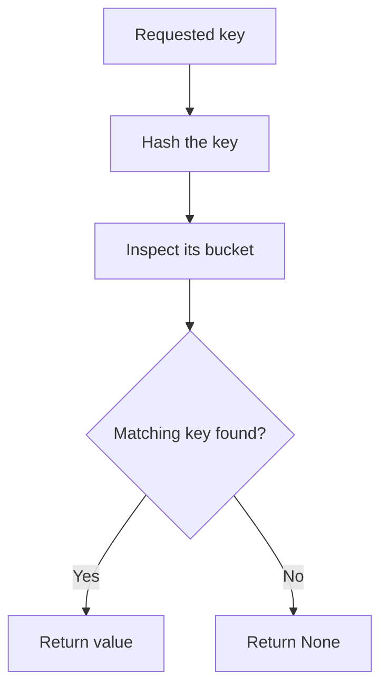

# Hash Tables

## Definition

A **hash table** stores key-value pairs. A hash function maps a key to an index so the table can find the corresponding bucket quickly. Python's built-in `dict` uses a hash-table-based mapping.

```text
Key       Hash function      Index
"apple" → hash("apple")   →   2
                              ↓
                         Bucket 2
                       ["apple", 10]
```

## How It Works

1. Provide a key.
2. Hash the key to calculate a bucket index.
3. Store or look up the key-value pair in that bucket.
4. Handle collisions when different keys map to the same index.

A bucket is a storage location; an index identifies that bucket. For a table of size 7, valid indices are 0–6.

## Hash Function

This educational hash function keeps the result within the table's valid indices:

```python
def hash_function(key, table_size):
    hash_value = 0

    for char in key:
        hash_value = (hash_value * 31 + ord(char)) % table_size

    return hash_value
```

- `ord(char)` converts a character to a number.
- Multiplication by 31 makes character position affect the result.
- The modulo operation keeps the index between `0` and `table_size - 1`.

This is a learning example, not a replacement for Python's built-in hashing. Different keys can still map to the same index.

## Collisions and Separate Chaining

A **collision** occurs when different keys map to the same index. With **separate chaining**, each bucket can hold multiple entries, commonly in a list.

```text
"apple" ──hash──┐
                ├──> Index 2 ──> ["apple", 10] ──> ["grape", 25]
"grape" ──hash──┘
```

Both entries remain in the bucket. A lookup must compare the actual key, not just the index.

## Core Methods

For this implementation, each bucket is either `None` or a list of `[key, value]` pairs.

### 1. `set_item(key, value)`

Adds a new pair or updates the value if the key already exists.

```python
def set_item(self, key, value):
    index = self._hash(key)

    if self.data_map[index] is None:
        self.data_map[index] = []

    for pair in self.data_map[index]:
        if pair[0] == key:
            pair[1] = value
            return

    self.data_map[index].append([key, value])
```

### 2. `get_item(key)`

Finds and returns a key's value, or `None` if the key is absent.

```python
def get_item(self, key):
    index = self._hash(key)
    bucket = self.data_map[index]

    if bucket is None:
        return None

    for pair in bucket:
        if pair[0] == key:
            return pair[1]

    return None
```

### 3. `keys()`

Returns all keys by visiting every non-empty bucket.

```python
def keys(self):
    all_keys = []

    for bucket in self.data_map:
        if bucket is not None:
            for pair in bucket:
                all_keys.append(pair[0])

    return all_keys
```

## Complete Implementation

```python
class HashTable:
    def __init__(self, size=7):
        self.data_map = [None] * size

    def _hash(self, key):
        hash_value = 0
        for char in key:
            hash_value = (hash_value * 31 + ord(char)) % len(self.data_map)
        return hash_value

    def set_item(self, key, value):
        index = self._hash(key)
        if self.data_map[index] is None:
            self.data_map[index] = []
        for pair in self.data_map[index]:
            if pair[0] == key:
                pair[1] = value
                return
        self.data_map[index].append([key, value])

    def get_item(self, key):
        index = self._hash(key)
        bucket = self.data_map[index]
        if bucket is None:
            return None
        for pair in bucket:
            if pair[0] == key:
                return pair[1]
        return None

    def keys(self):
        all_keys = []
        for bucket in self.data_map:
            if bucket is not None:
                for pair in bucket:
                    all_keys.append(pair[0])
        return all_keys

    def print_table(self):
        for index, bucket in enumerate(self.data_map):
            print(index, ":", bucket)


table = HashTable()
table.set_item("apples", 700)
table.set_item("plum", 300)
table.set_item("apples", 750)  # Updates the existing key

print(table.get_item("apples"))  # 750
print(table.get_item("plum"))    # 300
print(table.get_item("pear"))    # None
print(table.keys())
table.print_table()
```

## Set and Get Flow





## Time Complexity

Let `n` be the number of stored key-value pairs.

| Operation | Average case | Worst case |
|---|---:|---:|
| `set_item` | O(1) | O(n) |
| `get_item` | O(1) | O(n) |
| `keys` | O(n) | O(n) |

Good distribution keeps buckets small. If many keys collide in one bucket, insertion and lookup can degrade to O(n). `keys()` visits all entries, so it is O(n).

## Advantages and Limitations

**Advantages**
- Average-case insertion, update, and lookup can be very fast.
- Useful for dictionaries, frequency counts, caches, and mappings.

**Limitations**
- Collisions must be handled.
- Many collisions can reduce performance.
- Hash tables do not normally keep keys sorted.

## Common Mistakes

- Treating the bucket index as the key.
- Assuming every key has a unique index.
- Adding a duplicate entry instead of updating an existing key.
- Searching only by index without comparing the actual key.
- Assuming `keys()` is O(1).

## Mental Model

```text
Key → Hash function → Index → Bucket
                                  ├── one entry
                                  └── collision chain
```

**Remember:** a hash table uses a key to find a bucket quickly; collision handling preserves multiple entries that map to the same bucket.
