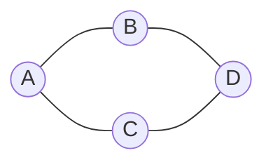
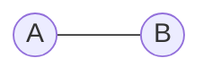
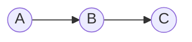
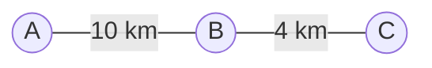
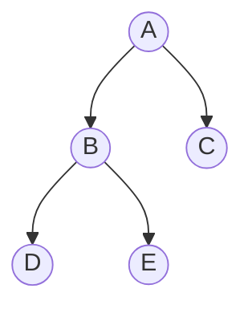
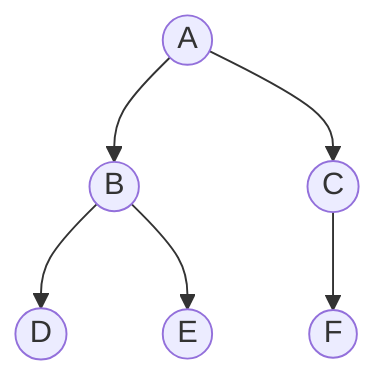

# Graphs — Notes & Methods

## 1. What Is a Graph?

A **graph** is a non-linear data structure made of **vertices (nodes)** and **edges (connections)** between them. Graphs model relationships, routes, dependencies, and networks.



- **Vertex / node:** an item in the graph.
- **Edge:** a connection between two vertices.
- **Adjacent vertices:** vertices joined directly by an edge.
- **Path:** a sequence of vertices connected by edges.
- **Cycle:** a path that returns to its starting vertex.
- **Degree:** the number of edges connected to a vertex in an undirected graph.
- **Weight:** a value on an edge, such as distance, time, or cost.

## 2. Common Graph Types

### Undirected graph

Edges have no direction. An edge between A and B means you can traverse it both ways.



### Directed graph (digraph)

Edges have directions, shown by arrows. A → B does not automatically mean B → A.



### Weighted graph

Each edge has a value, such as the travel distance between cities.



### Other useful distinctions

- **Connected graph:** every vertex can be reached from every other vertex in an undirected graph.
- **Disconnected graph:** at least one vertex or group has no path to another group.
- **Cyclic graph:** contains at least one cycle.
- **Acyclic graph:** contains no cycles.
- **Dense graph:** has many edges relative to the number of possible edges.
- **Sparse graph:** has relatively few edges.
- **DAG (directed acyclic graph):** a directed graph with no cycles, often used to represent dependencies.

## 3. Representing a Graph in Python

Two common representations are an **adjacency list** and an **adjacency matrix**.

### Adjacency list

An adjacency list stores each vertex with a list of its neighbors. It is usually a good default for sparse graphs.

```python
graph = {
    "A": ["B", "C"],
    "B": ["A", "D"],
    "C": ["A", "D"],
    "D": ["B", "C"],
}
```

The same connections can be pictured as:


For an undirected graph, each edge is normally listed in both endpoints' neighbor lists. For a directed graph, store only outgoing neighbors.

### Adjacency matrix

An adjacency matrix is a 2D table in which cell `[i][j]` indicates whether there is an edge from vertex `i` to vertex `j`. For an unweighted graph, use `1` for an edge and `0` for no edge.

For vertices ordered A, B, C, D:

```text
    A B C D
A [ 0 1 1 0 ]
B [ 1 0 0 1 ]
C [ 1 0 0 1 ]
D [ 0 1 1 0 ]
```

For an undirected graph, the matrix is symmetrical across its main diagonal.

### Representation comparison

| Operation / property | Adjacency list | Adjacency matrix |
|---|---|---|
| Space | O(V + E) | O(V²) |
| Check whether edge (u, v) exists | O(degree(u)) with a standard neighbor list | O(1) |
| Iterate over neighbors of u | O(degree(u)) | O(V) |
| Best fit | Often sparse graphs | Often dense graphs or frequent edge checks |

Here, `V` is the number of vertices and `E` is the number of edges.

## 4. Building and Using an Adjacency-List Graph

This class implements an **undirected graph**. A dictionary maps each vertex to its list of neighbors.

```python
class Graph:
    def __init__(self):
        self.adj = {}

    def add_vertex(self, vertex):
        """Add a vertex if it does not already exist."""
        if vertex not in self.adj:
            self.adj[vertex] = []

    def add_edge(self, v1, v2):
        """Add an undirected edge between v1 and v2."""
        self.add_vertex(v1)
        self.add_vertex(v2)

        if v2 not in self.adj[v1]:
            self.adj[v1].append(v2)
        if v1 not in self.adj[v2]:
            self.adj[v2].append(v1)

    def remove_edge(self, v1, v2):
        """Remove an edge if both vertices and the edge exist."""
        if v1 in self.adj and v2 in self.adj:
            if v2 in self.adj[v1]:
                self.adj[v1].remove(v2)
            if v1 in self.adj[v2]:
                self.adj[v2].remove(v1)

    def remove_vertex(self, vertex):
        """Remove a vertex and every edge connected to it."""
        if vertex not in self.adj:
            return

        for neighbor in self.adj[vertex]:
            self.adj[neighbor].remove(vertex)
        del self.adj[vertex]

    def get_neighbors(self, vertex):
        """Return the neighbors, or an empty list if absent."""
        return list(self.adj.get(vertex, []))

    def has_edge(self, v1, v2):
        """Return whether the edge exists."""
        return v1 in self.adj and v2 in self.adj[v1]

    def display(self):
        for vertex, neighbors in self.adj.items():
            print(f"{vertex}: {neighbors}")
```

### Example usage

```python
g = Graph()
g.add_edge("A", "B")
g.add_edge("A", "C")
g.add_edge("B", "D")

g.display()
# A: ['B', 'C']
# B: ['A', 'D']
# C: ['A']
# D: ['B']

print(g.has_edge("A", "B"))  # True
print(g.get_neighbors("A"))  # ['B', 'C']

g.remove_edge("A", "B")
g.remove_vertex("D")
```

**Implementation note:** These methods prioritize clarity. Checking for duplicate edges and removing a neighbor from a Python list take linear time in that neighbor list. Using sets for neighbors can make membership checks average O(1), but neighbor order is then not the focus.

## 5. Core Graph Operations and Typical Complexity

Let `V` be the number of vertices, `E` the number of edges, and `degree(v)` the number of neighbors of vertex `v`.

| Operation | Adjacency-list notes |
|---|---|
| Add vertex | O(1) average with a dictionary |
| Add edge | O(degree(u) + degree(v)) in this implementation because duplicate checks use lists |
| Check edge | O(degree(u)) with neighbor lists |
| Get neighbors | O(degree(v)) to copy the list; O(1) to retrieve the stored list itself |
| Remove edge | O(degree(u) + degree(v)) with list membership and removal |
| Remove vertex | O(degree(v)) neighbor visits, plus list-operation costs in neighbors |

Complexity depends on the representation and exact implementation. Big-O for an abstract operation is not always the same as the code-level cost.

## 6. Traversal: Visiting Vertices

**Graph traversal** is the process of visiting vertices systematically. The two foundational algorithms are **Depth-First Search (DFS)** and **Breadth-First Search (BFS)**.

### DFS — Depth-First Search

DFS follows one path as far as possible before backtracking. It can be implemented with recursion or an explicit stack.



One possible DFS order from A is A, B, D, E, C, depending on neighbor order.

```python
def dfs(graph, start):
    visited = set()
    order = []

    def visit(vertex):
        if vertex in visited:
            return
        visited.add(vertex)
        order.append(vertex)
        for neighbor in graph.get(vertex, []):
            visit(neighbor)

    if start in graph:
        visit(start)
    return order
```

### BFS — Breadth-First Search

BFS visits all immediate neighbors before moving to the next level. It uses a queue and is useful for finding shortest paths in **unweighted** graphs.



Starting from A, the levels are:

- Level 0: A
- Level 1: B, C
- Level 2: D, E, F

```python
from collections import deque

def bfs(graph, start):
    if start not in graph:
        return []

    visited = {start}
    queue = deque([start])
    order = []

    while queue:
        vertex = queue.popleft()
        order.append(vertex)

        for neighbor in graph.get(vertex, []):
            if neighbor not in visited:
                visited.add(neighbor)
                queue.append(neighbor)

    return order
```

Mark a vertex as visited **when adding it to the queue**. This prevents duplicate queue entries in graphs with cycles or multiple paths to the same vertex.

### DFS vs. BFS

| DFS | BFS |
|---|---|
| Explores deeply before backtracking | Explores level by level |
| Uses a stack or recursion | Uses a queue |
| Useful for reachability, cycle-related algorithms, and components | Useful for shortest paths in unweighted graphs and level distances |
| O(V + E) with an adjacency list | O(V + E) with an adjacency list |

These traversals visit only the part reachable from `start`. To traverse a disconnected graph completely, start another traversal from each unvisited vertex.

## 7. Common Graph Terms and Algorithms

- **Connected components:** separate connected groups in an undirected graph; find them with repeated DFS/BFS.
- **Reachability:** whether a path exists from one vertex to another; DFS/BFS can test it.
- **Shortest path:** a path with minimum total length or cost. BFS works for unweighted edges; Dijkstra's algorithm is used for non-negative edge weights.
- **Topological ordering:** a linear order that respects directed dependencies; possible only for a DAG.
- **Cycle detection:** determines whether a cycle exists; the method depends on whether the graph is directed or undirected.
- **Minimum spanning tree:** a minimum-total-weight set of edges connecting all vertices of a connected, weighted, undirected graph.

## 8. Where Graphs Are Used

- **Social networks:** users are vertices and relationships are edges.
- **Maps:** locations are vertices, roads are edges, and distance or time can be weights.
- **Computer networks:** devices are vertices and links are edges.
- **Dependencies:** tasks or packages are vertices and prerequisite relationships are directed edges.
- **Recommendations:** users and items can be represented as connected vertices.

## 9. Common Mistakes

- Treating a directed edge as automatically bidirectional.
- In an undirected graph, forgetting to record both directions in an adjacency list.
- Forgetting to track visited vertices, causing repeated work or infinite traversal loops when cycles exist.
- Assuming BFS always finds the shortest path in a weighted graph. Its shortest-path guarantee applies to unweighted graphs (or equal edge costs).
- Removing a vertex without removing references to it from its neighbors.
- Assuming every graph is connected, or that every graph is a tree. A tree is a connected, acyclic, undirected graph.

## 10. Quick Recap

- A graph consists of vertices and edges.
- An adjacency list stores neighbors; an adjacency matrix stores edge existence in a table.
- DFS uses a stack or recursion and explores deeply; BFS uses a queue and explores level by level.
- With an adjacency list, DFS and BFS take O(V + E) time when each vertex and edge is processed a constant number of times.
- Choose the representation and algorithm based on graph density, edge direction, weights, and the problem being solved.
