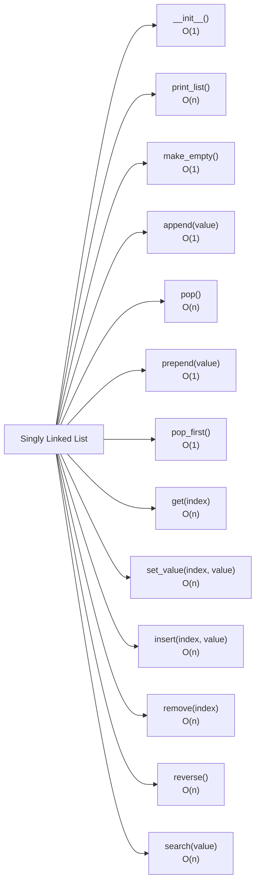

## What is a Linked List?
A **singly linked list** is a linear data structure made of **nodes**. Each node stores a value and a reference to the next node.
A node can be visualized as:
```plain text
[value | next]
```
- **value** → the data stored in the node
- **next** → a reference to another node
- The last node's next points to None
A typical linked list keeps track of:
- **head** → the first node
- **tail** → the last node
- **length** → number of nodes
Example:
```plain text
head
 ↓
[10 | •] → [20 | •] → [30 | None]
                              ↑
                             tail
length = 3
```
> **Linked list = a chain of objects connected by references.**
---
## Linked List vs Python List
A Python list supports direct index access:
```plain text
[10][20][30][40]
       ↑
    list[2]
```
A linked list must follow references one node at a time:
```plain text
head
 ↓
[10] → [20] → [30] → [40]
 0       1       2       3
                  ↑
                index 2
```
So:
> **Python list → random access**
>
> **Linked list → sequential access**
This difference explains many of the Big-O results you see later.
---
## Why Linked Lists Matter
The important part of a linked list is not the boxes. It is the **connections between the boxes**.
Suppose:
```plain text
A → B
```
Insert X between them:
```plain text
A → X → B
```
The operation changes references rather than shifting a whole block of elements.
### Main trade-off
**Good at**
- adding/removing at the head
- appending when a tail reference exists
- changing links when you already have the correct node
**Not good at**
- random index access
- searching for an arbitrary value
- finding a node that requires long traversal
---
## Node Class
A basic Node can be represented with a class:
```python
class Node:
    def __init__(self, value):
        self.value = value
        self.next = None
```
When we create a node:
```python
new_node = Node(10)
```
we can picture:
```plain text
new_node
   │
   ▼
[ value: 10 | next: None ]
```
The variable new_node holds a **reference** to the Node object.
Now:
```python
node_a.next = node_b
```
means:
```plain text
node_a
  │
  ▼
[10 | next] ─────→ [20 | None]
                    ▲
                    │
                  node_b
```
The node is not copied. A reference to another object is stored in next.
---
## Linked List Structure
A typical LinkedList class starts like this:
```python
class LinkedList:
    def __init__(self, value):
        new_node = Node(value)
        self.head = new_node
        self.tail = new_node
        self.length = 1
```
Visual model:
```plain text
self.head ───────┐
                 ▼
              [10] → [20] → [30] → None
                                  ↑
                              self.tail

self.length = 3
```
### Important invariants
These should remain true after every method:
1. In a non-empty list, head points to the first node.
2. tail points to the last node.
3. `tail.next` is None.
4. length matches the actual number of nodes.
5. In an empty list: head = None, tail = None, length = 0.
These invariants are extremely useful when debugging.
---
## Method Overview

> **Core pattern:** if the operation already has the node/reference it needs, it can often be O(1). If it must walk through the list first, it is usually O(n).
---
## 1. Constructor — O(1)
The constructor creates the first node and initializes the linked list.
```python
def __init__(self, value):
    new_node = Node(value)
    self.head = new_node
    self.tail = new_node
    self.length = 1
```
After creation:
```plain text
head
 ↓
[10 | None]
 ↑
tail

length = 1
```
Only a fixed number of operations are performed.
**Time: O(1)**
---
## 2. print_list() — O(n)
Purpose: visit every node and print its value.
```python
def print_list(self):
    temp = self.head

    while temp is not None:
        print(temp.value)
        temp = temp.next
```
Think of temp as a temporary reference moving through the chain:
```plain text
head → [10] → [20] → [30] → None
         ↑
        temp
```
Each iteration moves temp to the next node.
### Why use temp?
Do not move self.head while traversing.
self.head is the list's permanent reference to the first node. temp is the temporary reference used for walking through the list.
**Time: O(n)** because every node may be visited.
---
## 3. make_empty() — O(1)
Purpose: clear the list.
Conceptually:
```python
def make_empty(self):
    self.head = None
    self.tail = None
    self.length = 0
```
Before:
```plain text
head → [10] → [20] → [30] ← tail
length = 3
```
After:
```plain text
head = None
tail = None
length = 0
```
We do not need to traverse the chain to remove the list's references to it.
**Time: O(1)**
---
## 4. append(value) — O(1)
Purpose: add a node to the end.
Before:
```plain text
[10] → [20] → [30] → None
                        ↑
                       tail
```
Append 40:
```python
new_node = Node(40)
self.tail.next = new_node
self.tail = new_node
self.length += 1
```
### Step 1 — Connect the old tail
```python
self.tail.next = new_node
```
```plain text
[10] → [20] → [30] → [40]
                        ↑
                    new_node
```
### Step 2 — Move tail
```python
self.tail = new_node
```
Final:
```plain text
[10] → [20] → [30] → [40] → None
                           ↑
                          tail
```
> **Memory rule: connect → move tail**
Doing only self.tail = new_node would move the tail reference without connecting the old last node to the new node.
Because tail already gives direct access to the last node:
**Time: O(1)**
Without a tail reference, finding the last node would require traversal → **O(n)**.
---
## 5. pop() — O(n)
Purpose: remove the last node.
Before:
```plain text
head
 ↓
[10] → [20] → [30] → None
                        ↑
                       tail
```
To remove 30, we need node 20:
```plain text
[10] → [20] → [30]
        ↑
    new tail
```
Then conceptually:
```python
second_last.next = None
self.tail = second_last
self.length -= 1
```
### Why is this O(n)?
A singly linked list only stores a next reference.
There is no previous reference:
```plain text
[10] → [20] → [30]
                      ↑
                    tail

tail cannot move backward
```
So we must start at head and find the node before tail.
### Edge cases
**Empty list:** nothing can be removed.
**One-node list:** removing it gives head = None, tail = None, length = 0.
**Time: O(n)**
---
## 6. prepend(value) — O(1)
Purpose: add a node to the beginning.
Before:
```plain text
head
 ↓
[10] → [20] → [30]
```
Create 5:
```python
new_node = Node(5)
new_node.next = self.head
self.head = new_node
self.length += 1
```
Visual:
```plain text
new_node
   ↓
  [5]
   │
   └────────→ [10] → [20] → [30]
```
Final:
```plain text
head
 ↓
[5] → [10] → [20] → [30]
```
No traversal is needed.
**Time: O(1)**
### Empty-list case
The new node becomes both head and tail.
```plain text
head
 ↓
[5]
 ↑
tail
```
---
## 7. pop_first() — O(1)
Purpose: remove the first node.
Before:
```plain text
head
 ↓
[10] → [20] → [30]
```
The second node is already available through `head.next`.
```python
self.head = self.head.next
self.length -= 1
```
After:
```plain text
head
 ↓
[20] → [30]
```
### One-node case
After removing the only node:
```plain text
head = None
tail = None
length = 0
```
Only a constant number of reference changes are required.
**Time: O(1)**
---
## 8. get(index) — O(n)
Purpose: return the node at a given index.
Example:
```plain text
index:   0        1        2        3
        [10] → [20] → [30] → [40]
                              ↑
                            get(3)
```
A linked list cannot jump to index 3. It must follow the chain:
```plain text
10 → 20 → 30 → 40
     1    2    3 steps
```
Typical traversal:
```python
temp = self.head

for _ in range(index):
    temp = temp.next

return temp
```
The exact implementation may also validate the index.
### Important distinction
If you already have the node reference, reading its value is O(1).
The expensive part is **finding the node**.
**Time: O(n)**
---
## 9. set_value(index, value) — O(n)
Purpose: change the value stored in a node.
Before:
```plain text
[10] → [20] → [30]
```
After set_value(1, 99):
```plain text
[10] → [99] → [30]
```
Conceptually:
```python
node = self.get(index)

if node is not None:
    node.value = value
```
Two stages:
- Find the node → **O(n)**
- Change the value → **O(1)**
Therefore:
**O(n) + O(1) = O(n)**
---
## 10. insert(index, value) — O(n)
Purpose: insert a new node at a particular index.
Example: insert 99 at index 1.
Before:
```plain text
index:  0      1      2
       [10] → [20] → [30]
```
After:
```plain text
index:  0      1      2      3
       [10] → [99] → [20] → [30]
```
Suppose the relevant part is:
```plain text
A → B
```
Create X.
The reference changes are:
```plain text
X.next = B
A.next = X

A → X → B
```
### Special cases
- index = 0 → use prepend()
- index = length → use append()
- otherwise → find the node before the insertion point
- invalid index → handle according to the implementation
> **Insertion changes connections; it does not require shifting every node like an array insertion.**
The link changes themselves are O(1), but finding the correct location requires traversal.
**Time: O(n)**
---
## 11. remove(index) — O(n)
Purpose: remove a node at a specific index.
Example:
```plain text
Before:

[10] → [20] → [30] → [40]

Remove index 1

After:

[10] → [30] → [40]
```
Suppose:
```plain text
A → B → C
```
To remove B:
```python
A.next = B.next
```
Result:
```plain text
A → C
```
B is no longer part of the chain.
### Main steps
1. Find the node before the target.
2. Make its next point to the target's next.
3. Update tail when removing the last node.
4. Decrease length.
### Special cases
- index = 0 → use pop_first()
- removing the last index → update tail
- removing the only node → the list becomes empty
The reference change is O(1), but locating the target is generally O(n).
**Time: O(n)**
---
## 12. reverse() — O(n)
Purpose: reverse the direction of all links.
Before:
```plain text
head
 ↓
[10] → [20] → [30] → [40] → None
                              ↑
                             tail
```
After:
```plain text
head
 ↓
[40] → [30] → [20] → [10] → None
                              ↑
                             tail
```
This is one of the most important linked-list algorithms because it requires careful reference manipulation.
### Three-reference model
At each step, think about:
```plain text
previous ← current → next_node
```
Conceptually:
```python
previous = None
current = self.head

while current is not None:
    next_node = current.next
    current.next = previous
    previous = current
    current = next_node

self.head = previous
```
### Why save next_node first?
Suppose:
```plain text
A → B → C
```
If you change `A.next` before saving B, you can lose the path to the rest of the list.
So the safe sequence is:
> **Save → reverse → advance**
1. Save the original next node.
2. Reverse the current link.
3. Move previous forward.
4. Move current to the saved next node.
### Head and tail
Before:
```plain text
head → 10 → 20 → 30 → 40 ← tail
```
After:
```plain text
head → 40 → 30 → 20 → 10 ← tail
```
The old head becomes the new tail, and the old tail becomes the new head.
**Time: O(n)**  
**Extra space: O(1)**
---
## 13. search(value) — O(n)
Purpose: determine whether a value exists in the list.
Example:
```plain text
Search for 30

[10] → [20] → [30] → [40]
                  ↑
                found
```
Algorithm:
1. Start at head.
2. Compare the current node's value.
3. Move to `current.next`.
4. Stop when a match is found or the reference becomes None.
Worst case:
```plain text
[10] → [20] → [30] → [40] → [50] → None
                                        ↑
                                   not found
```
The value may be at the end or may not exist.
**Time: O(n)**
---
## Traversal Pattern
Many linked-list methods share the same basic pattern:
```python
temp = self.head

while temp is not None:
    # work with temp
    temp = temp.next
```
Mental model:
```plain text
head
 ↓
node 1
 ↓
node 2
 ↓
node 3
 ↓
None
```
Every time temp moves to `temp.next`, the reference moves one node forward.
This pattern powers:
- printing
- searching
- finding an index
- finding the last node
- finding the node before another node
- many other linked-list algorithms
---
## References and Mutability
Linked lists are a practical way to understand Python's object-reference model.
Suppose:
```python
a = Node(10)
b = a
```
Now:
```plain text
a ──┐
    ├──→ [10 | ...]
b ──┘
```
Both variables refer to the **same object**.
If we do:
```python
a.next = Node(20)
```
the shared Node object has been mutated:
```plain text
a ──┐
    ├──→ [10] → [20]
b ──┘
```
### Reassignment vs mutation
a = b
→ **reassignment**
The variable a is changed so it refers to the object that b refers to.
`a.next` = b
→ **mutation**
The Node object referenced by a is being changed.
This distinction is one of the most important ideas behind linked-list code.
---
## The Most Important Reference Pattern
When writing a linked-list method, ask:
> **Which node am I holding?**
>
> **Which node should its next reference point to afterward?**
### Insert
Before:
```plain text
A → B
```
Insert X:
```plain text
X.next = B
A.next = X

A → X → B
```
### Remove
Before:
```plain text
A → B → C
```
Skip B:
```plain text
A.next = C

A → C
```
### Reverse
Before:
```plain text
A → B → C
```
After:
```plain text
A ← B ← C
```
The Python code is just a way of expressing these reference changes.
---
## Edge Cases You Should Always Test
### Empty list
```plain text
head = None
tail = None
length = 0
```
Ask what the method should return or do.
### One-node list
```plain text
head
 ↓
[10]
 ↑
tail
```
Especially important for pop(), pop_first(), remove(), and reverse().
### Two-node list
```plain text
head
 ↓
[10] → [20]
         ↑
        tail
```
This is a very useful test because many reference mistakes appear here.
### First index
Index 0 usually changes head.
### Last index
The final index may change tail.
### Invalid index
Decide whether the method should return None, False, raise an error, or otherwise reject the operation based on the implementation.
---
## Common Mistakes
### 1. Moving self.head during traversal
Avoid:
```python
while self.head is not None:
    self.head = self.head.next
```
This destroys the list's reference to the first node.
Instead:
```python
temp = self.head

while temp is not None:
    temp = temp.next
```
### 2. Forgetting to update tail
Whenever the last node changes, ask:
> **Does tail still point to the actual last node?**
### 3. Forgetting length
Every insertion/removal should leave:
```plain text
length == actual number of nodes
```
### 4. Losing the rest of the list
Before changing `current.next`, make sure you still have a reference to the original next node when you need it.
This is especially important in reverse().
### 5. Forgetting empty and one-node cases
The middle of a list is usually easier. The boundaries are where many bugs hide.
---
## Why tail = new_node Is Not Enough
Before:
```plain text
[10] → [20] → [30]
                 ↑
                tail
```
If you only do:
```python
self.tail = new_node
```
you get a detached node:
```plain text
old chain: [10] → [20] → [30]

tail ───────────────→ [40]
```
The new node exists, but it is not connected to the chain.
Correct order:
```python
self.tail.next = new_node
self.tail = new_node
```
> **Connect the new node first. Then move the tail.**
---
## Singly Linked List Complexity
<table header-row="true">
<tr>
<td>Operation</td>
<td>Time</td>
<td>Main reason</td>
</tr>
<tr>
<td>Constructor</td>
<td>**O(1)**</td>
<td>Fixed number of operations</td>
</tr>
<tr>
<td>print_list()</td>
<td>**O(n)**</td>
<td>Visit every node</td>
</tr>
<tr>
<td>make_empty()</td>
<td>**O(1)**</td>
<td>Reset head, tail and length</td>
</tr>
<tr>
<td>append()</td>
<td>**O(1)**</td>
<td>Tail gives direct access</td>
</tr>
<tr>
<td>pop()</td>
<td>**O(n)**</td>
<td>Find second-to-last node</td>
</tr>
<tr>
<td>prepend()</td>
<td>**O(1)**</td>
<td>Change head reference</td>
</tr>
<tr>
<td>pop_first()</td>
<td>**O(1)**</td>
<td>Change head reference</td>
</tr>
<tr>
<td>get(index)</td>
<td>**O(n)**</td>
<td>Traverse to index</td>
</tr>
<tr>
<td>set_value(index, value)</td>
<td>**O(n)**</td>
<td>Find node first</td>
</tr>
<tr>
<td>insert(index, value)</td>
<td>**O(n)**</td>
<td>Traverse to insertion point</td>
</tr>
<tr>
<td>remove(index)</td>
<td>**O(n)**</td>
<td>Traverse to target/previous node</td>
</tr>
<tr>
<td>reverse()</td>
<td>**O(n)**</td>
<td>Visit every node</td>
</tr>
<tr>
<td>search(value)</td>
<td>**O(n)**</td>
<td>May inspect every node</td>
</tr>
</table>
---
## Important Big-O Lesson
Do not memorize:
> "One loop = O(n)."
Instead ask:
> **How many times does the important operation execute as n grows?**
For example, append uses a constant number of reference changes:
```plain text
tail → new node
```
So it is O(1).
But pop needs to find the node before tail:
```plain text
head → node → node → node → ... → tail
          ↑
       may need to walk n nodes
```
So it is O(n).
The difference comes from **whether traversal is required**.
---
## Singly Linked List vs Python List
<table header-row="true">
<tr>
<td>Operation</td>
<td>Singly Linked List</td>
<td>Python List</td>
</tr>
<tr>
<td>Access by index</td>
<td>O(n)</td>
<td>O(1)</td>
</tr>
<tr>
<td>Search</td>
<td>O(n)</td>
<td>O(n)</td>
</tr>
<tr>
<td>Insert at beginning</td>
<td>O(1)</td>
<td>O(n)</td>
</tr>
<tr>
<td>Remove at beginning</td>
<td>O(1)</td>
<td>O(n)</td>
</tr>
<tr>
<td>Append</td>
<td>O(1) with tail</td>
<td>O(1) amortized</td>
</tr>
<tr>
<td>Extra per-node link</td>
<td>Yes, next</td>
<td>No explicit next reference</td>
</tr>
</table>
The high-level trade-off is:
> **Linked list: easier link changes, slower access.**
>
> **Python list: faster indexing, expensive shifts near the beginning.**
---
## Debugging Checklist
When the list behaves strangely, draw it.
For example:
```plain text
head
 ↓
[10] → [20] → [30] → None
                 ↑
                tail

length = 3
```
Then trace the references after each line.
Ask:
1. Where does head point?
2. Where does tail point?
3. What does `current.next` point to?
4. Did I accidentally disconnect part of the chain?
5. Is `tail.next` still None?
6. Does length still equal the number of nodes?
A debugger is especially useful because you can watch head, tail, current, temp, and next references change one line at a time.
---
## Easy Memory Rules
> **Head operations → O(1)**
>
> **Append → O(1) when a tail reference exists**
>
> **Index access → O(n)**
>
> **Searching → O(n)**
>
> **Traversal → O(n)**
>
> **Changing a link is O(1) once you already have the correct node**
### Core Mental Model
A linked list is best understood as:
```plain text
nodes + references between nodes
```
When solving a method, think in this order:
```plain text
1. Where am I?
2. Which node do I need?
3. Which reference must change?
4. What should it point to?
5. Did head, tail, and length remain correct?
```
> **Draw the arrows first. Write the Python second.**
That mental model is the foundation for understanding stacks, queues, trees, graphs, and other reference-based data structures.